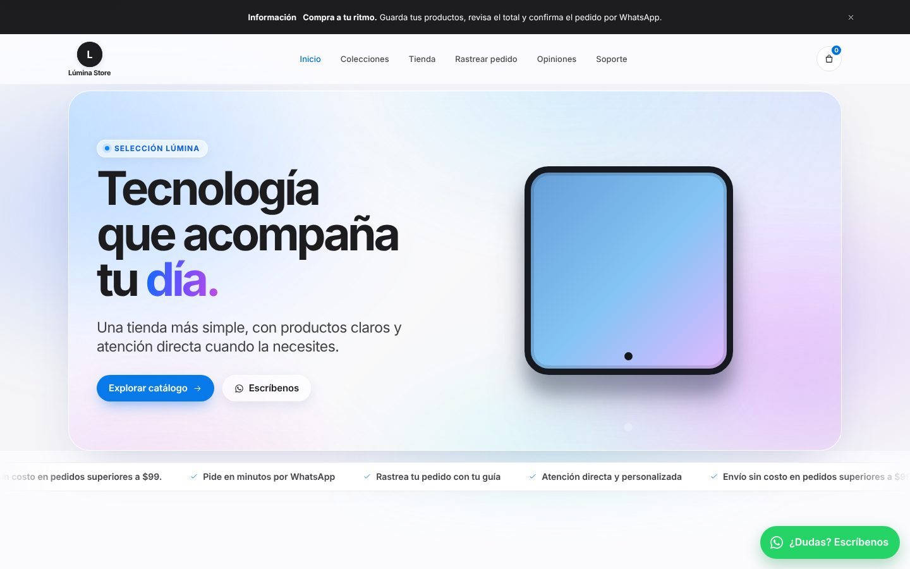
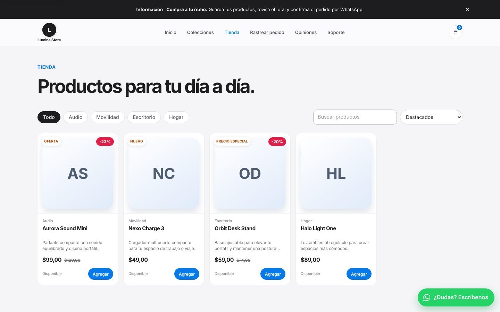
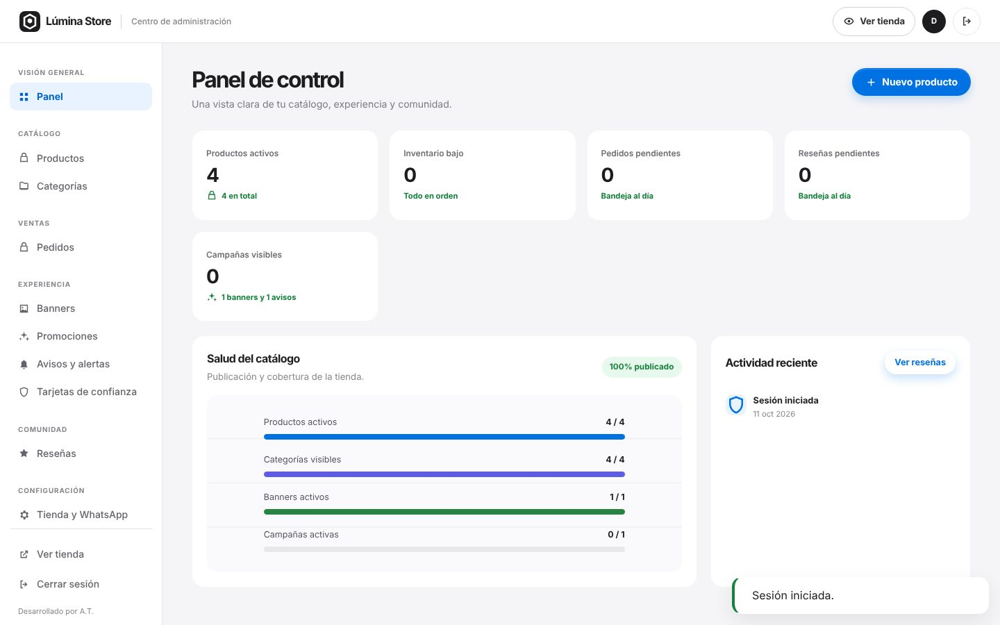

# Lúmina Store — primera versión de producción

Lúmina Store es una tienda PHP + MySQL preparada para catálogo, administración, imágenes y pedidos por WhatsApp. El código que recibe peticiones web vive en `public/`; la aplicación, configuración y datos de instalación deben permanecer fuera del directorio público.

No existen credenciales de administrador incluidas, ni deben añadirse al repositorio. El primer propietario se crea una vez, de forma local o por SSH, con el script incluido.


## Capturas

**Página de inicio**



**Catálogo con filtros y ofertas**



**Panel de administración**



_Capturas tomadas con datos de prueba._

## Requisitos

- PHP 8.2 o superior con `pdo_mysql`, `mbstring`, `fileinfo` e `iconv` habilitados.
- MySQL 8.0+ o MariaDB 10.6+ con `utf8mb4`.
- Apache con `mod_rewrite` y `mod_headers`, o un servidor equivalente configurado para servir solamente `public/`.
- HTTPS activo en el dominio final.

Estructura del proyecto:

```text
lumina-store-production/
├── app/                  lógica PHP, autenticación y repositorios
├── config/               configuración de la aplicación
├── database/             esquema y contenido inicial no sensible
├── public/               único directorio expuesto por el servidor web
│   ├── assets/           estilos y JavaScript
│   ├── uploads/          imágenes validadas subidas desde Admin
│   ├── index.php         tienda pública
│   ├── admin.php         panel de administración
│   └── api.php           API de la aplicación
├── scripts/              tareas CLI; nunca se exponen por la web
├── storage/logs/         logs de aplicación, fuera del sitio público
├── .env.example          plantilla de configuración
└── README.md
```

## Instalación local

1. Copia `.env.example` como `.env` en la raíz del proyecto. `.env` contiene secretos: no lo subas a Git ni lo dejes dentro de `public/`.

2. Crea una base de datos y un usuario MySQL con permisos solamente sobre esa base. Completa `DB_HOST`, `DB_PORT`, `DB_NAME`, `DB_USER`, `DB_PASS` y `APP_URL` en `.env`.

3. Para una instalación nueva de ejemplo, importa primero el esquema y después el contenido inicial. El orden es importante:

   ```bash
   mysql -u TU_USUARIO -p TU_BASE_DE_DATOS < database/schema.sql
   mysql -u TU_USUARIO -p TU_BASE_DE_DATOS < database/seed.sql
   ```

   Para publicar el contenido que ya configuraste en la demostración local, genera en cambio una exportación segura y úsala **en lugar de** `seed.sql`:

   ```bash
   php scripts/export-local-content.php --force
   mysql -u TU_USUARIO -p TU_BASE_DE_DATOS < database/schema.sql
   mysql -u TU_USUARIO -p TU_BASE_DE_DATOS < database/local-content.mysql.sql
   ```

   La exportación incluye contenido público de tienda, categorías, productos, imágenes, variantes, banners, campañas, avisos, tarjetas de confianza, reseñas y la configuración visible. No incluye usuarios, contraseñas, pedidos, actividad, límites ni correos de reseñas. Copia también `public/uploads/` conservando las rutas, porque el SQL solo registra los archivos de imagen.

4. Crea el propietario inicial. El comando solicita correo, nombre y contraseña; la contraseña se lee sin mostrarla en pantalla:

   ```bash
   php scripts/create-admin.php
   ```

   También puedes proporcionar correo y nombre para evitar esas dos preguntas. Evita pasar la contraseña como argumento salvo en una automatización protegida, porque la línea de comandos puede quedar en el historial o ser visible temporalmente a otros procesos.

   ```bash
   php scripts/create-admin.php --email=propietario@tu-dominio.tld --name="Propietario"
   ```

5. Durante desarrollo, sirve `public/` como raíz del servidor. Por ejemplo, desde la raíz del proyecto:

   ```bash
   php -S localhost:8080 -t public
   ```

   Visita `http://localhost:8080/` para la tienda y `http://localhost:8080/admin` para iniciar sesión.

## Despliegue en Hostinger

La regla central es sencilla: **solamente `public/` puede ser accesible desde Internet**. Conserva la estructura de hermanos para que las rutas internas de PHP funcionen sin exponer secretos:

```text
/home/USUARIO/
└── lumina-store-production/
    ├── .env
    ├── app/
    ├── config/
    ├── database/
    ├── scripts/
    ├── storage/
    └── public/  ← raíz web del dominio
```

1. En hPanel crea la base de datos y un usuario específico de la aplicación. Asígnale únicamente esa base y guarda sus valores en `.env`.

2. Sube el proyecto completo a un directorio privado de tu cuenta. Configura el *document root* del dominio o subdominio en `lumina-store-production/public`. Si tu plan usa obligatoriamente `public_html`, solicita al soporte de Hostinger que configure ese directorio como raíz web o crea un enlace/control de dominio que apunte a `public/`. No copies `app/`, `config/`, `database/`, `scripts/`, `storage/` ni `.env` dentro de `public_html`.

3. Sube `.env` por un canal seguro y cambia todos los valores de ejemplo. Usa `APP_ENV=production`, `APP_DEBUG=false`, una URL HTTPS final y una contraseña de base de datos única. Ajusta `UPLOAD_MAX_BYTES` de acuerdo con los límites de PHP y del hosting.

4. Desde phpMyAdmin importa `database/schema.sql` y luego una sola fuente de contenido: `database/seed.sql` para ejemplos, o `database/local-content.mysql.sql` para publicar la configuración local actual. La segunda se genera con `php scripts/export-local-content.php --force` antes de empaquetar el proyecto. Ninguna crea un administrador.

5. Ejecuta una vez `php scripts/create-admin.php` por SSH desde la raíz privada del proyecto. Si el plan no incluye SSH, no conviertas este script en una página web temporal: pide a soporte acceso de terminal o ejecuta el comando desde un entorno de administración autorizado que tenga acceso a la base de datos.

6. Otorga permiso de escritura al usuario del servidor únicamente sobre `public/uploads/` y `storage/logs/`. Empieza por `0755`; usa `0775` solamente si el proveedor lo exige. Nunca uses `0777`. Comprueba que `public/uploads/.htaccess` se haya subido y siga bloqueando ejecución de PHP.

7. Activa SSL, redirige HTTP a HTTPS desde hPanel y comprueba que `/`, `/admin` y `/api.php?resource=public` respondan desde el dominio final.

## Operación del panel

El propietario creado por el script puede iniciar sesión en `/admin`. Desde el panel se administran el nombre, logo, icono, contactos, redes sociales y opciones generales de la tienda; también categorías, productos, variantes, imágenes, banners, avisos, campañas, tarjetas de confianza y el sistema opcional de reseñas.

En **Tienda y WhatsApp** aparece una sección separada de **Cuenta de administración**. Permite cambiar el nombre, correo y contraseña de la cuenta activa. Para modificar correo o contraseña se exige la contraseña actual; el cambio renueva la sesión de forma segura. Las redes se muestran en el pie público únicamente cuando se ha configurado un enlace HTTPS válido.

En cada producto, las variantes se crean con **Grupo de variante** (por ejemplo, `Color`) y **Valor de variante** (por ejemplo, `Negro`). La ficha pública las presenta en un único desplegable y actualiza precio, SKU, disponibilidad y cantidad al escoger una opción. Asigna stock a cada variante para que pueda pedirse.

El crédito fijo **“Desarrollado por A.T.”** es parte del pie de página público y no forma parte de las opciones editables del panel.

## Pedidos y seguimiento de envíos

Cada pedido sigue un único flujo, visible igual en el panel y para el cliente:

`Pedido recibido → En preparación → Enviado → En reparto → Entregado`, más **Novedad** (por ejemplo, el cliente no estaba en casa) y **Cancelado**.

- **Guía de la tienda (CS-…):** se crea con el pedido, va en el mensaje de WhatsApp y no cambia nunca, así los enlaces que tiene el cliente siempre funcionan.
- **Guía de la transportadora:** es un campo aparte (Servientrega, Laar, etc.). El cliente puede rastrear con cualquiera de las dos en `seguimiento.php`.
- **Stock:** se descuenta una sola vez, al confirmar el pedido. Vuelve al stock si se cancela o se elimina un pedido que no fue entregado. Los pedidos creados antes de esta versión no mueven el inventario.
- **Reglas del panel:**
  - Para marcar un pedido como "Enviado" hay que indicar la transportadora.
  - Una "Novedad" requiere un mensaje para el cliente.
  - "Entregado" y "Cancelado" son estados definitivos.
- **Aviso al cliente:** después de cada cambio, el panel ofrece abrir WhatsApp con un mensaje listo que incluye el estado y el enlace de seguimiento.
- **Envío gratis:** en *Tienda y WhatsApp → Envío gratis desde* defines el subtotal mínimo (por ejemplo 99). El carrito muestra cuánto falta y el servidor aplica la misma regla al crear el pedido. Mantén el aviso de envío con el mismo valor.
- **Mis pedidos:** las guías de los pedidos hechos desde un dispositivo quedan guardadas en ese navegador y aparecen en la página de seguimiento. No se necesitan cuentas.
- **Privacidad:** la consulta pública nunca muestra nombre, teléfono, dirección ni productos, solo el estado y la ciudad de destino. Las consultas fallidas tienen un límite por cliente.

La base de datos se actualiza sola la primera vez que se carga el panel o la tienda con esta versión: se agregan columnas y la columna de estado pasa de ENUM a texto. No hace falta importar nada en phpMyAdmin.

## Copias de seguridad y seguridad operativa

- Haz una copia diaria de la base de datos y una copia del árbol `public/uploads/`; se necesitan ambas para restaurar productos e imágenes coherentemente.
- Antes de actualizar, exporta la base y conserva una copia fechada de los archivos. Prueba la actualización en una copia o subdominio antes de llevarla al dominio principal.
- Mantén PHP, MySQL/MariaDB y extensiones actualizados. Revisa los registros de errores sin activar `APP_DEBUG` en producción.
- Protege `.env`: sin permisos públicos de lectura y fuera de la raíz web. Rota la contraseña de base de datos si se comparte o se sospecha exposición.
- Usa una contraseña larga y exclusiva para cada cuenta del panel. Desactiva o elimina usuarios que ya no deban administrar la tienda.
- No subas copias de bases de datos, imágenes originales privadas ni archivos de configuración a un repositorio público.
- Verifica después de cada despliegue que un archivo PHP colocado dentro de `uploads/` no se pueda ejecutar y que los listados de directorio estén deshabilitados.

## Lista de salida a producción

- [ ] `.env` real, privado y con `APP_DEBUG=false`.
- [ ] Base importada en orden: esquema, luego seed.
- [ ] Propietario creado sin credenciales de ejemplo.
- [ ] `public/` configurado como única raíz web.
- [ ] HTTPS, redirección HTTP→HTTPS y URL final comprobados.
- [ ] Subida de una imagen, edición de producto y pedido de prueba a WhatsApp verificados.
- [ ] Número de WhatsApp, textos de envío, logo, redes sociales, banners, avisos y políticas revisados.
- [ ] Backups de base de datos y `public/uploads/` programados y probados.
